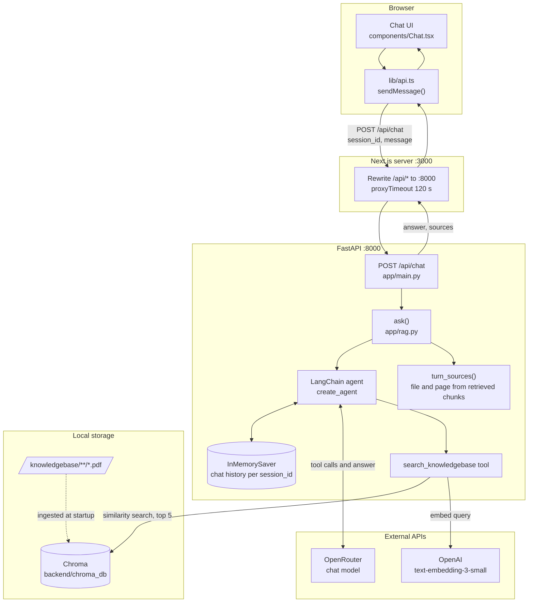
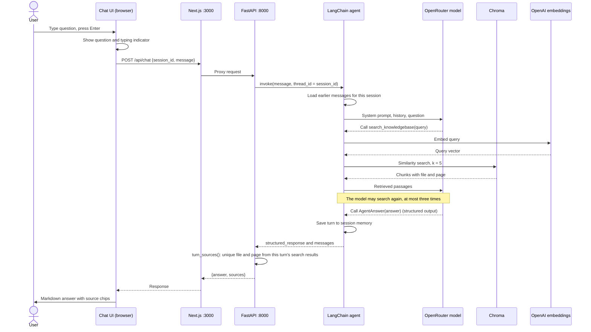
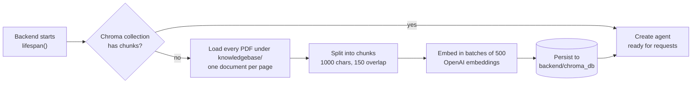

# Workflow

How a question travels from the browser to the backend and back. Diagrams use Mermaid.

## Architecture

## Asking a question

If the request fails, the UI shows an inline error and the user can send the question again.

## Startup ingestion

Runs once, when the backend starts with an empty vector store (or manually with `uv run python -m app.ingest`).

## Sessions

- The browser creates a `session_id` with `crypto.randomUUID()`. "New chat" creates a new one.
- The backend uses it as the LangGraph `thread_id`, so follow-up questions see the earlier conversation.
- History is held in memory only and is lost when the backend restarts.
